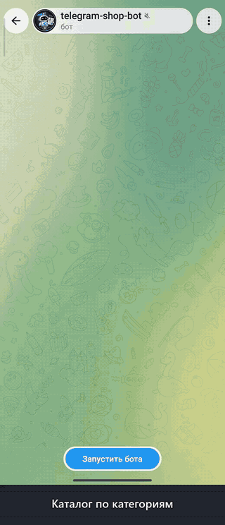

# Telegram Shop Bot: catalog, cart, orders

<p align="center"></p>

🇷🇺 [Русская версия](README.md) · The demo GIF shows the Russian UI; set `BOT_LANG=en` for English.

aiogram 3 · SQLite (aiosqlite) · Docker

An online shop inside Telegram — no website needed. The owner manages the catalog right in the bot.

## Features

**Client**
- Catalog by categories, product cards with photos, ◀️ ▶️ browsing
- Cart with +/− buttons, stored in the database (survives restarts)
- Checkout: name, phone (button or typed), pickup or delivery with an address, comment
- Delivery price, free delivery from an amount, minimum order
- Payment instructions shown in the summary before confirmation
- “My orders” with statuses, cancelling a new order, status change notifications

**Admin**
- Catalog management inside the bot: `/add` — step-by-step product creation (category → name → description → price → photo)
- `/products`, `/p ID` — product card with buttons: price, stock, hide/show, delete
- Orders arrive as cards in private messages or a team group (`ORDERS_CHAT_ID`) with status buttons: “Confirmed / Shipped / Completed / Cancelled”
- `/orders [status]`, `/order ID`, `/export` — CSV for Excel, `/stats` — orders and revenue for today / 7 / 30 days, top products

**Reliability**
- Name and price are frozen in the order: catalog changes don't alter past orders
- If the price changes between the summary and confirmation, the client sees the new total and confirms again
- Out-of-stock, hidden or deleted products can't be added or ordered
- Creating the order and clearing the cart is one transaction
- Orders-per-hour limit per client

## Demo mode

`DEMO_MODE=1` is for showing the bot to potential clients. Instead of payment details the client sees “no payment needed”, and after ordering gets a copy of the owner's card with working status buttons — for their own order only. Catalog management, admin commands and other people's orders stay inaccessible.

## Language

`BOT_LANG=ru` (default) or `BOT_LANG=en` switches the whole interface: buttons, messages, dates and price format (`CURRENCY=$` → `$1,200`). The language applies to the whole bot instance — run a separate instance with its own token for each language. Source strings are written in Russian and wrapped in `_()`; translations live in `bot/locales/en.py`, and `tests/test_i18n.py` makes sure none are missing.

## Run

```bash
cp .env.example .env   # set BOT_TOKEN, ADMIN_IDS, BOT_LANG=en
```

Docker:
```bash
docker compose up -d --build
```

Without Docker (Python 3.11+):
```bash
python -m venv .venv && . .venv/bin/activate
pip install -r requirements.txt
python -m bot
```

The catalog is empty at first — send `/add` to the bot from an admin account.

## Settings (`.env`)

| Variable | Default | Description |
|---|---|---|
| `BOT_TOKEN` | — | Token from @BotFather |
| `ADMIN_IDS` | — | Comma-separated admin Telegram IDs |
| `ORDERS_CHAT_ID` | — | Team group ID (otherwise — private messages to admins) |
| `BOT_LANG` | `ru` | Interface language: `ru` or `en` |
| `SHOP_NAME` | `Магазин` / `Shop` | Name in the greeting |
| `CURRENCY` | `₸` | Currency symbol |
| `PAYMENT_INFO` | — | Payment instructions, `\n` — line break |
| `PICKUP_ADDRESS` | — | Pickup address |
| `DELIVERY_ENABLED` | `1` | `0` — pickup only |
| `DELIVERY_PRICE` | `0` | Delivery price |
| `FREE_DELIVERY_FROM` | `0` | Free delivery from this amount (`0` — never) |
| `MIN_ORDER` | `0` | Minimum order amount |
| `MAX_ORDERS_PER_HOUR` | `5` | Orders-per-hour limit per client |
| `TIMEZONE` | `Asia/Almaty` | Time zone |
| `DEMO_MODE` | `0` | Demo mode for showing to clients |

## Structure

```
bot/
  __main__.py      entry point, command menus for clients and admins
  config.py        settings from .env
  i18n.py          _() translation function, BOT_LANG
  locales/en.py    English translations
  db.py            SQLite: categories, products, carts, orders
  delivery.py      sending and updating order cards
  keyboards.py     keyboards and CallbackData
  states.py        checkout and product wizard states
  utils.py         formatting, statuses, totals
  handlers/
    client.py      catalog, cart, checkout, “My orders”
    admin.py       catalog and order management, statistics
tests/             end-to-end tests without Telegram
```

## Tests

```bash
python -m tests.test_flow   # full scenario (Russian UI)
python -m tests.test_en     # English UI: scenario + no Cyrillic in any message or button
python -m tests.test_i18n   # every string is wrapped in _() and translated
```
